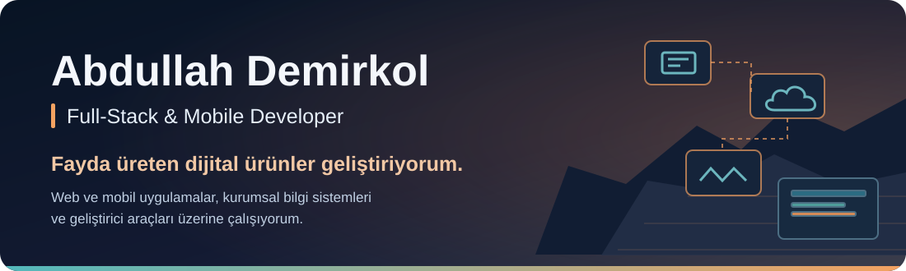
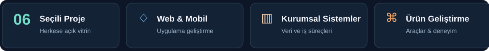
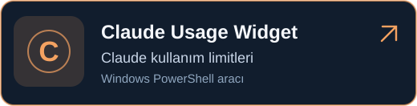
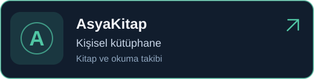
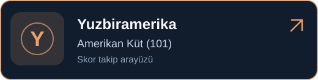

 

### 🚀 Neler Yapıyorum?

Web ve mobil uygulamalar, kurum içi bilgi sistemleri ve geliştirici araçları geliştiriyorum. Kullanışlı ürünler oluştururken **sürdürülebilir mimari**, **güvenilir veri akışları** ve **anlaşılır kullanıcı deneyimi** üzerine odaklanıyorum.

### 🛠️ Teknoloji Setim

### 📦 Ürünler ve Projelerim

<table>
<tr>
<td width="50%"></td>
<td width="50%"></td>
</tr>
<tr>
<td width="50%"></td>
<td width="50%"></td>
</tr>
<tr>
<td width="50%"></td>
<td width="50%"></td>
</tr>
</table>

> Projeler farklı geliştirme aşamalarındadır. Mimari, kurulum ve mevcut özelliklerle ilgili bilgiler için ilgili depoların README dosyalarını inceleyebilirsiniz.

### 🧭 Odak Alanlarım

- **Full-stack geliştirme:** Web uygulamaları, API tasarımı ve veri modelleme
- **Mobil geliştirme:** React Native ve Expo ile platformlar arası uygulamalar
- **Kurumsal yazılımlar:** Rol tabanlı yetkilendirme, iş akışı, raporlama ve veri yönetimi
- **Geliştirici araçları:** İş akışlarını kolaylaştıran yardımcı uygulamalar

<strong>English summary</strong>

I develop web and mobile applications, internal information systems, and practical developer tools. My main stack includes TypeScript, React, Next.js, React Native/Expo, Node.js, Prisma, PostgreSQL and Docker. I care about maintainable architecture, reliable data flows and useful products.

---

**Fayda üreten, sürdürülebilir yazılımlar geliştirmek.**

